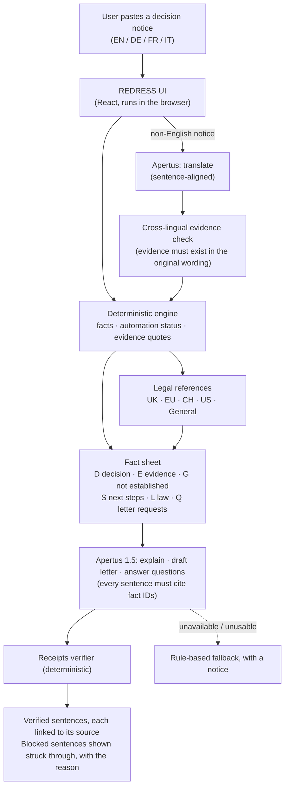
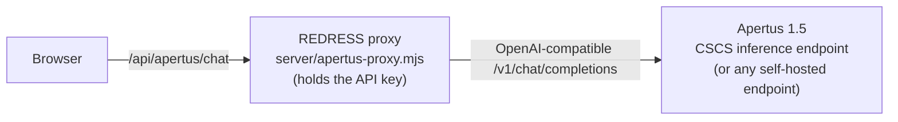

# REDRESS

**When an AI makes a decision about you, know what to do next.**

REDRESS helps people who receive a decision (a refused loan, a suspended account, a rejected claim or application) work out whether automation or AI was involved, what the evidence does and does not show, which rights or routes *may* apply, and how to challenge it. It runs on **Apertus 1.5**, Switzerland's open language model, and every sentence the model writes is checked by **Receipts** before it is shown as verified.

> REDRESS is an information tool, not legal advice. All demo cases are fictional.

---

## The problem

Automated and AI-assisted systems increasingly decide who gets credit, insurance, housing, work, or access to a platform. The people affected usually get a short letter that:
- does not say whether a person or a system decided;
- names no specific reason;
- does not mention any right to explanation or human review;
- may be in a language that is not their first.

Most people don't know which questions to ask, and generic AI chatbots will confidently invent rights, deadlines and legal conclusions. For someone challenging a decision, an invented "you have 30 days" or "this is unlawful" can do real harm.

## What REDRESS does

1. **Analyse.** Paste a decision notice in English, German, French or Italian. A deterministic engine extracts the organisation, outcome, date, stated reason and references, and classifies automation as *Confirmed automated*, *Possibly automated / AI-assisted*, *Not established* or *Human decision indicated*. Every classification is backed by verbatim quotes from the notice, alongside what the evidence does **not** establish.
2. **Jurisdiction.** Legal references for the **UK, EU, Switzerland and US**, or general procedural guidance. Each reference states when it applies, its limits, whether human review is required or merely requestable, and how current it is.
3. **Act.** Rights and options worded conditionally, a step-by-step action plan, and an editable challenge letter.
4. **Explain, in your language.** Apertus explains the result, drafts the letter, and answers free-form questions, in English, German, French or Italian. **Receipts checks every sentence.**
5. **Track.** Evidence vault, timeline and challenge status.

## Architecture



How the model is reached:



**Design principle: the engine decides, Apertus writes, Receipts checks.** Apertus never decides whether a decision was automated or which law applies. That stays deterministic and testable. Apertus does what language models are good at: translating, explaining and drafting in plain language. Receipts makes sure what it writes stays within what REDRESS established.

## Why Apertus

- **Multilingual by design.** Apertus is trained on more than 1,800 languages, and REDRESS needs German, French and Italian for Switzerland.
- **Open and self-hostable.** Model weights, training data and code are open. A deployment handling people's decision letters can run on infrastructure the operator controls. The proxy accepts any OpenAI-compatible endpoint, so moving from the CSCS endpoint to a self-hosted one is a configuration change.
- **Two sizes.** The 8B and 70B models trade quality for cost differently; see the benchmark below.

## Receipts: how unsupported claims are blocked

Apertus receives a numbered **fact sheet** and must cite fact IDs for every sentence. `src/apertus/receipts.ts` then checks each sentence deterministically:

| Check | Blocks a sentence that… |
|---|---|
| Citations | cites nothing, or cites IDs that do not exist (fabricated citations) |
| Numbers | contains a number not present in the cited facts (an invented deadline, article or amount) |
| Quotes | quotes text that is not verbatim in the cited evidence, including a translation presented as a quote |
| Law | names a statute or article that is not in a cited legal reference for the selected jurisdiction (GDPR/DSGVO/RGPD, FADP/DSG/LPD, …) |
| Automation | says automation or AI was used without citing evidence of it |
| Human decision | says a person made or reviewed the decision without citing evidence of it |
| Solely automated | claims a solely automated decision that REDRESS did not establish |
| Legal conclusions | states a conclusion or guarantee ("unlawful", "rechtswidrig", "illégal", "illegittimo", "you will win"…) |

Verified sentences show a shield; clicking one shows its sources and highlights the exact sentence in the user's original notice, even when that notice was in another language. Blocked sentences stay visible, struck through, with the reason. Greetings and sign-offs make no factual claim and are not counted as verified.

Additional safeguards:
- **Translations cannot add evidence.** A translated sentence is kept only if its source text appears in the original. Automation or human evidence is counted only if matching wording exists in the original language.
- **Untrusted input.** Quoted notice text and user questions are passed as delimited data, and the model is told to ignore instructions inside them. Even if a model obeys an injected instruction, Receipts still checks the output.
- **Fallback.** If the model times out, errors or returns unusable output, REDRESS shows its rule-based output with a notice. One narrow, documented JSON repair handles a common small-model formatting error; repaired output is still fully verified.

**Limits:** Receipts checks facts, numbers, quotes, law, automation and human-decision claims, and legal conclusions. It cannot judge tone or every nuance of meaning, and the UI says so.

## Jurisdictions

| | Frameworks (each with conditions, limits and currency notes) |
|---|---|
| UK | UK GDPR Art. 22 / 22A–22D (Data (Use and Access) Act 2025), Arts. 13–15, ICO, Financial Ombudsman Service |
| EU | GDPR Art. 22, Arts. 13–15, AI Act (high-risk systems, Arts. 26, 85, 86), Data Protection Authorities |
| Switzerland | FADP Art. 21 (automated individual decisions), Art. 25 (access, including the logic of an automated decision), FDPIC |
| US | FCRA, ECOA / Regulation B, state laws (e.g. Colorado AI Act), CFPB / state Attorneys General |
| General | Procedural guidance only, no legal rights claimed |

The legal text was last reviewed in October 2026. Swiss provisions were checked against several published summaries; the official text on fedlex.admin.ch could not be fetched from the build environment, and the app says so.

## Languages

- **Notices:** English, German, French, Italian. Non-English notices are translated by Apertus.
- **Generated text** (explanations, letters, answers): English, German, French, Italian.
- **Interface:** English only.

## Benchmark: Apertus 1.5 8B vs 70B

BENCHMARK_RESULTS_PLACEHOLDER

## Repository structure

```
src/
  lib/            deterministic engine: extraction, automation status, rights, action plan, letter
  legal/          legal references per jurisdiction (conditions, limits, currency)
  ai/             rule-based "Explain It To Me" answers
  apertus/        language layer: fact sheet, prompts, Receipts, pipeline, clients, stand-in model
  components/     React UI (ReceiptsView, ApertusPanel, …)
  __tests__/      unit and integration tests
server/           apertus-proxy.mjs: key-holding proxy to the Apertus endpoint (+ tests)
benchmarks/       8B vs 70B benchmark: fixtures, runner, metrics, results
scripts/          opt-in live check against a running proxy
docs/APERTUS.md   language-layer details
```

## Setup

Requirements: Node.js 22.21 or newer, and npm.

```bash
npm install
npm run dev            # http://localhost:5173, using the in-browser stand-in model
```

By default the app uses a clearly labelled **stand-in model** ("Stand-in model (mock — not Apertus)"), so it runs without credentials. To use real Apertus:

```bash
cp .env.example .env   # then edit .env
npm run proxy          # terminal 1: key-holding proxy on 127.0.0.1:8787
npm run dev            # terminal 2: Vite forwards /api to the proxy
```

### Environment variables

| Variable | Where it is read | Purpose |
|---|---|---|
| `VITE_APERTUS_MODE` | browser build | `mock` (default), `apertus` (real model via the proxy) or `off` (rule-based only) |
| `APERTUS_API_KEY` | proxy only | Endpoint key. Never give it a `VITE_` prefix (that would ship it to the browser). Can be left unset if your environment injects the credential. |
| `APERTUS_BASE_URL` | proxy only | OpenAI-compatible `/v1` URL; defaults to `https://api.inference.cscs.ch/v1` |
| `APERTUS_MODEL` | proxy only | Optional; defaults to Apertus 1.5 70B from the endpoint's model list |
| `APERTUS_PROXY_PORT` | proxy only | Default `8787` |

## Tests and checks

```bash
npm test               # unit + integration tests
npm run typecheck
npm run lint
npm run build
npm run test:live      # opt-in: six real cases through a running proxy
npm run benchmark:apertus
```

## Privacy and security

- The API key stays in the proxy and is never included in the browser bundle (checked by a test and against the production build).
- In `mock` mode nothing leaves the browser. In `apertus` mode the notice text is sent to the configured Apertus endpoint, and the start screen says so.
- REDRESS stores nothing on a server. Case data lives in the browser session.
- The proxy validates requests, caps model parameters and never echoes upstream error bodies.
- `.env` is git-ignored. The full git history has been scanned for credentials (none found).

## Known limitations

- **Coverage.** The automation analysis is pattern-based and works on English text, which is why non-English notices are translated first. Unusual wording can be missed.
- **Legal references.** They are summaries, not legal advice, and the law changes (several entries carry currency notes).
- **Receipts' scope.** It checks claims, not tone or completeness.
- **Server needed for real Apertus.** Real-Apertus features need the proxy (or an equivalent serverless function), so a static hosting deploy runs the stand-in or rule-based mode only.
- **Interface language.** The UI is English; only generated content is multilingual.
- **Stand-in model.** It can only translate the built-in demo notices.
- **Inputs.** Screenshot and PDF upload accept pasted text only.

## Licence

Apache License 2.0; see [LICENSE](LICENSE).

## Hackathon

Built for **Hack Apertus 2026** (Track 2B, Apertus Adoption: Own Project). Demo script: [DEMO_SCRIPT.md](DEMO_SCRIPT.md) · Devpost draft: [DEVPOST.md](DEVPOST.md) · Submission checklist: [SUBMISSION_CHECKLIST.md](SUBMISSION_CHECKLIST.md).
