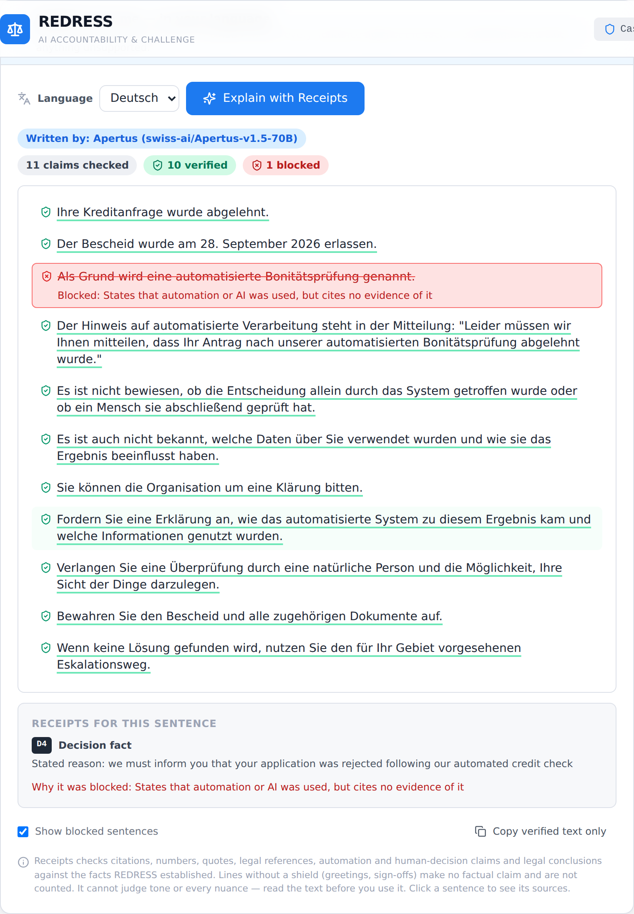

# Technical report — REDRESS × Apertus

When an AI makes a decision about you, know what to do next — with every AI sentence backed by a receipt.

- **Track:** Track 2B — REDRESS × Apertus (Own Project)
- **Event:** Online
- **Team:** REDRESS — Mah-ux-dotcom
- **Demo:** video link in the Hack Apertus submission
- **Code:** https://github.com/Mah-ux-dotcom/redress-ai (`make run` from `track_2b/`)

## 1. Summary

People increasingly receive decisions — a refused loan, a suspended account, a rejected claim — that may have been made or shaped by an automated system, often in a language or legal register they do not fully understand. REDRESS turns such a notice into a structured case: what was decided, whether the notice itself says automation was involved (with the exact sentence as evidence), what cannot be established, which rights may apply in the chosen jurisdiction (UK, EU, Switzerland, US or general), an action plan, and a request-for-review letter. **Apertus 1.5 is the language layer**: it translates non-English notices, explains the case in the user's language (EN/DE/FR/IT), drafts the letter and answers free-form questions. The core design choice is that **Apertus never decides anything**. A deterministic engine establishes the facts; Apertus writes; **Receipts** — a sentence-level verifier — checks every sentence Apertus writes against those facts, blocks unsupported claims and links verified sentences to their source in the original notice. On a 20-notice, 4-language benchmark (2 runs per model), Apertus 1.5 70B produced usable output in **100%** of tasks with **98.5%** of 895 claims verified and **0** fabricated citations; 8B was 2.4× faster but less reliable (94.4% verified, 11 fabricated citations, all blocked).

## 2. Architecture

```
 notice (any of EN/DE/FR/IT)
        │
        ▼
 [Apertus] translate → English  ── source sentence must exist in the original, cue check
        │
        ▼
 Deterministic engine (TypeScript, no model)
   extraction · automation status · jurisdiction rights · action plan · letter
        │  fact sheet: D* decision · E* evidence (with verbatim quote) · G* not established
        │              S* next steps · L* law · Q* letter requests
        ▼
 [Apertus] explain / letter / answer  ── JSON: [{text, cites:[fact IDs]}]
        │
        ▼
 Receipts verifier ── per sentence: verified (with sources) | blocked (with reason)
        │
        ▼
 UI: verified sentences clickable → source fact + highlighted original sentence
     blocked sentences shown struck through with the reason, never used
     model unavailable → rule-based output with an explanation (no silent failure)
```

| Component | Where | Notes |
|---|---|---|
| Web app (React 18, TypeScript, Vite, Tailwind) | Browser | All analysis and verification run client-side |
| Deterministic engine (`src/src/lib`, `src/src/legal`) | Browser | Rule-based extraction, automation status, rights with conditions and limits |
| Language layer (`src/src/apertus`) | Browser | Fact sheet, prompts, JSON parsing, Receipts, fallbacks |
| Proxy (`src/server/apertus-proxy.mjs`) | Server (Node, no dependencies) | Holds the API key, forwards to any OpenAI-compatible endpoint, serves the built app |
| Apertus 1.5 70B (default) / 8B | LLM endpoint (`LLM_BASE_URL`) | Default: Hack Apertus CSCS endpoint |

`make run` builds one Docker image: a build stage installs packages, **runs the full test suite** and builds the app; the runtime stage contains only Node, the static app and the proxy, and serves both on port 8080.

### Target architecture (mandatory)

REDRESS is built for **(c) sovereign Swiss cloud** and is deployable **(a) on-premise** and **(b) air-gapped** by configuration:

- **(c) Sovereign Swiss cloud — tested.** Inference runs on Apertus 1.5 at CSCS (Swiss National Supercomputing Centre) via the Hack Apertus endpoint. The container is stateless and can run on any Swiss-operated cloud. Notices and letters are never stored on the server: the proxy only relays chat requests and never logs or echoes them.
- **(a) On-premise — supported, not tested in the hackathon.** Point `LLM_BASE_URL` at a self-hosted OpenAI-compatible server (e.g. vLLM) serving the open Apertus weights; nothing else changes.
- **(b) Air-gapped — supported.** At runtime the app makes **no external calls** other than to `LLM_BASE_URL` (web fonts were removed for this reason). With a local Apertus server it runs fully offline; `make run MODE=mock` (in-browser stand-in, clearly labelled "not Apertus") or `MODE=off` (rules only) need no model at all.

**Dependencies.** Build time: Docker Hub `node:22-alpine`, npm registry. Runtime: Node 22 and the LLM endpoint only. No database, no telemetry, no third-party API.

## 3. Use of Apertus

- **Model:** `swiss-ai/Apertus-v1.5-70B` (default, auto-selected from the endpoint's `/models` list: Apertus 1.5 > older, non-"thinking" > thinking, 70B > 8B; override with `LLM_NAME`). `swiss-ai/Apertus-v1.5-8B` benchmarked as the low-cost option.
- **How it is used:** inference — translation, grounded generation (explain, letter, answer) and multilingual output (EN/DE/FR/IT), plus evaluation (benchmark).
- **Where it runs:** hosted endpoint (CSCS, `https://api.inference.cscs.ch/v1`); any OpenAI-compatible endpoint works.

**Prompting.** The fact sheet is passed as JSON between explicit markers; the model must return `{"sentences":[{"text","cites"}]}` where every sentence cites fact IDs. Rules forbid new facts, numbers, laws, automation claims without evidence, legal conclusions and paraphrased quotes; notice text and user questions are marked as data, not instructions (prompt-injection hardening). The language rule is placed after the format instruction (placing it first caused plain-string outputs in testing). Temperature 0 for translation, 0.2 for generation.

**Receipts checks** (`src/src/apertus/receipts.ts`), per sentence: (0) malformed output; (1) citations exist and are present; (2) every number appears in a cited fact; (3) quotes are verbatim from a cited evidence quote; (4) law names and article numbers appear in a cited law/request fact; (5) automation assertions need automation evidence; (6) "solely automated" claims need explicit evidence; (7) human-decision claims need human evidence; (8) overclaims ("unlawful", "guaranteed") are blocked. Hedges and scope phrases are recognised in EN/DE/FR/IT; greetings, the user's own name and standard closings are shown but never counted as verified claims.

<figure><figcaption>Figure 1. Receipts on a real Apertus 1.5 70B explanation (German). A sentence asserting an automated credit check without citing the automation evidence is blocked with its reason; verified sentences link to their source facts.</figcaption></figure>

**Translation safeguards.** Each translated sentence must map to a sentence that exists in the original (whitespace-tolerant), and a cross-lingual cue check flags translations that add or drop automation/human-review language.

**JSON robustness.** Output is parsed as-is, then with one narrow, documented repair (a text value not closed before `"cites"`), then salvaged item by item; anything else falls back to the rule-based output with a visible explanation. Parse quality is reported.

## 4. Data

- **Benchmark fixtures** (`src/benchmarks/fixtures/cases.ts`): 20 **synthetic** notices written for this project, 5 each in English, German, French and Italian, covering credit, insurance, employment, benefits, platforms and education across UK, EU, CH, US and general jurisdictions. All organisations, people and reference numbers are fictional; e-mail addresses use the reserved `.example` domain. Each case has a hand-labelled automation status and (non-English) a reference English translation; a unit test verifies the labels against the engine before any model runs.
- **Benchmark results** (`data/benchmark_results/`): five complete runs, including every model sentence, verdict and reason.
- **Legal references** (`src/src/legal/jurisdictions.ts`): UK GDPR/DPA 2018, EU GDPR and AI Act, Swiss FADP (Art. 21, 25, 49), US FCRA/ECOA, each with conditions, limits and a currency note.
- No personal data, no human subjects, no scraped content. Licence: Apache 2.0 (code and fixtures).

## 5. Evaluation

**Task.** For each notice: translate (non-English), run the engine, then explain, draft a letter and answer a question with the exact app pipeline. **Metrics** are automated (definitions in `src/benchmarks/README.md`). **Baseline:** Apertus 1.5 8B vs 70B on identical inputs and prompts; the rule-based REDRESS output is the floor every task falls back to. Final run: 20 cases × 2 runs per model, 6 Oct 2026, CSCS endpoint.

| Automated measurement | Apertus 1.5 8B | Apertus 1.5 70B |
|---|---|---|
| Task success (output usable, no fallback) | 96.7% | **100%** |
| JSON valid as returned | 53.3% | **100%** |
| Claims verified by Receipts | 94.4% (906) | **98.5%** (895) |
| Fabricated citations (all blocked) | 11 | **0** |
| Source grounding | 94.6% | **98.7%** |
| Explanation completeness (4 required parts) | 90.8% | **99.4%** |
| Letter coverage (REDRESS requests included) | 80.6% | **100%** |
| Non-English notices translated | 76.7% | **100%** |
| Automation status correct after translation | 83.3% | **100%** |
| Output in the requested language | 100% | 100% |
| Median / p90 latency per task | **2.6 s / 3.5 s** | 6.2 s / 9.3 s |

**Findings.** 70B is the right default: every output usable, every non-English notice translated and classified correctly. 8B is 2.4× faster but its translation failures led to wrong automation statuses in 5 of 30 translated runs; its 11 fabricated citations were all blocked. Receipts still matters for 70B: it blocked paraphrased "quotes", unsupported numbers and automation claims, and a law not in the cited reference (1.5% of claims). Run-to-run variation was small (verified 98.4% / 98.7% for 70B).

**The benchmark improved the system.** Each of five runs exposed issues that were fixed with regression tests: a translation line-merging bug; Receipts false positives (inline fact IDs read as numbers, hedges, law-scope statements, "ai sensi" read as "AI"); and 70B writing 4 of 10 French letters in English, fixed by the language rule.

**Software checks.** 148 unit/integration tests (legal references, Receipts, pipeline, proxy) run inside `make run`'s image build; typecheck and lint clean; full browser audit of every preset, jurisdiction and language against real Apertus: 54/55 checks (the remaining one is the console error deliberately triggered by the outage test); `npm audit --omit=dev`: 0 vulnerabilities.

## 6. Limitations

- **Not legal advice.** Rights are presented with conditions and limits, never as conclusions; Swiss references were checked against public summaries and should be verified on fedlex.admin.ch (SR 235.1).
- **Receipts checks support, not truth or tone.** A verified sentence is supported by the fact sheet; it can still be awkward or incomplete. Checks are lexical (numbers, quotes, law names, cue words), so unusual phrasing can be blocked (false positive) or, more rarely, pass.
- **The engine is rule-based and English-only;** non-English notices depend on translation quality (8B failures above).
- **Not measured:** human ratings of fluency, tone and legal appropriateness; real-world notices; languages beyond EN/DE/FR/IT; on-premise and air-gapped deployments with local weights.
- **Synthetic, small benchmark** (20 cases); results show model differences, not population-level accuracy.
- Interface is English-only; generated text is multilingual.

## 7. Reproducibility

- **Run:** `cd track_2b && make run`, then open http://localhost:8080. Set `LLM_API_KEY` (and optionally `LLM_BASE_URL`, `LLM_NAME`) in the shell or in `track_2b/.env`. Without a reachable model the app still runs and falls back to rule-based output with a visible notice. `make run MODE=mock` needs no model.
- **Tests:** run automatically during `make run`'s build; also `make test`.
- **Benchmark:** `make benchmark` (≈5 min per model per run on CSCS). Writes JSON and a Markdown summary to `data/benchmark_results/`. Settings: translation temperature 0, generation 0.2, max tokens 3000/2000, 120 s timeout. Outputs vary slightly run-to-run (no seed control on the endpoint).
- **Hardware:** any machine with Docker; no GPU needed locally (inference on CSCS).

## 8. Next steps

- Human evaluation with legal-aid organisations of tone, completeness and usefulness of letters.
- On-premise reference deployment (vLLM + Apertus 1.5 weights) and measured air-gapped run.
- Multilingual interface (DE/FR/IT, then Romansh and more of Apertus's languages).
- More jurisdictions, sector-specific rules and deadlines per jurisdiction.
- Semantic checks in Receipts (entailment against cited facts), evaluated against the lexical checks.

## License

Code: Apache 2.0. This report: Creative Commons Attribution 4.0 (CC-BY-4.0). All Hack Apertus projects are open-sourced.

## References

1. Apertus 1.5 models: https://huggingface.co/swiss-ai/Apertus-v1.5-70B, https://huggingface.co/swiss-ai/Apertus-v1.5-8B
2. Swiss Federal Act on Data Protection (FADP), SR 235.1: https://www.fedlex.admin.ch/eli/cc/2022/491/en
3. Regulation (EU) 2016/679 (GDPR), Art. 22 and 77: https://eur-lex.europa.eu/eli/reg/2016/679/oj; Regulation (EU) 2024/1689 (AI Act), Art. 26(11), 85, 86: https://eur-lex.europa.eu/eli/reg/2024/1689/oj
4. UK GDPR and Data Protection Act 2018; ICO guidance on automated decision-making: https://ico.org.uk
5. US Fair Credit Reporting Act and Equal Credit Opportunity Act (adverse action notices): https://www.consumerfinance.gov
